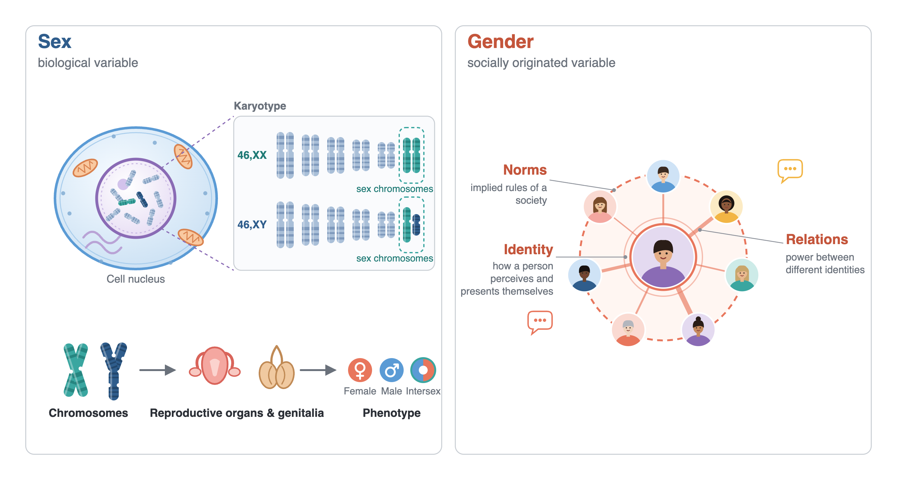

Recently, while submitting a couple of papers, I came across a new but important note in the *information for authors* sections of several journal websites. It asks authors to use the terms "sex" and "gender" appropriately and not interchangeably. This prompted me to read up on the topic and clarify the distinction, both for myself and for anyone else interested. If you would rather not see your papers rejected by meticulous journals, I suggest reading on.

The first journal to draw my attention to this distinction was one from the Lancet group. In the [information for authors of *Lancet Global Health*](https://www.thelancet.com/pb-assets/Lancet/authors/tlgh-info-for-authors.pdf){target="_blank"}, which should be read carefully before submission (it can improve your chances of acceptance), the journal encourages authors of all article types to use "sex" when reporting biological factors and "gender" when reporting identity-related, psychological, or cultural factors. The journal also recommends reporting sex and gender as separate variables and describing how each was determined when presenting participants' demographics. This approach makes it much easier to pool subgroup data across studies, for example in meta-analyses.

For a more detailed discussion, I refer to an [editorial published in *BMJ Global Health*](https://gh.bmj.com/content/3/4/e001038){target="_blank"} in 2018, which introduced the journal's new editorial policy on the correct use of the words sex and gender.[@peters2018sex] The authors define "sex" as a **biological** variable that classifies humans and other animals as male, female, or intersex on the basis of their reproductive organs and genitalia, which derive from their chromosomes (XX in most women and XY in most men). The term should therefore be used only when discussing sex-related biological or physiological differences. "Gender," by contrast, is a **socially** constructed term that refers to the roles, behaviors, and activities that a given society assigns to people in a given context and time.

{width="100%" fig-align="center"}

 

Unlike sex, which can be identified through phenotype or genotype (for example, by karyotype testing), gender has no specific measurement method, and it can change along a continuum over time. Understanding gender identity (how a person perceives and presents their gender), gender norms (the implicit rules in societies that shape individual attitudes and behaviors), and gender relations (the power relations between different gender identities) can help researchers handle this variable.

Once the difference between sex and gender, and the appropriate use of each term, is understood, the need for equity in research on these two distinct concepts becomes clear. This need led to the development of the [Sex and Gender Equity in Research (SAGER)](https://link.springer.com/article/10.1186/s41073-016-0007-6){target="_blank"} guideline,[@heidari2016sex] and in recent years many journals have mandated adherence to it. These guidelines aim to counter sex and gender inequity in medical and other research and to facilitate [sex-based and gender-based analyses and interpretations](https://jamanetwork.com/journals/jama/fullarticle/2577142){target="_blank"}.[@clayton2016reporting]

In this piece, I have explained the difference between the terms sex and gender and how using each one correctly can help the scientific community and policymakers think more clearly about sex- and gender-related variation.