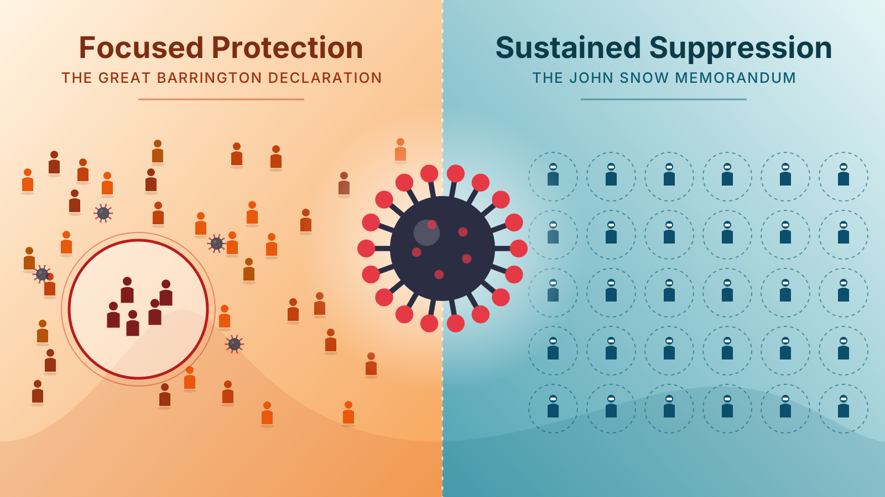

::: {.callout-note appearance="simple" }

This article was written before any COVID-19 vaccine was available and before the emergence of SARS-CoV-2 variants. The information it contains reflects the knowledge available at that time.

:::

Recently, I watched a live episode of *Conversations with Dr. Bauchner* on JAMA Network titled "Herd Immunity as a Pandemic Strategy," and I found the ideas discussed worth sharing. The recorded stream is available [here](https://www.linkedin.com/video/live/urn:li:ugcPost:6730589836031406081/){target="_blank"}.

The conversation featured Dr. Jay Bhattacharya, MD, PhD, of Stanford University's Center for Primary Care and Outcomes Research, and Dr. Marc Lipsitch, PhD, of the Harvard T.H. Chan School of Public Health. Each guest defended his own view on how to restrain the COVID-19 pandemic effectively while minimizing harm to the population, and each supported one of the two global initiatives I briefly describe below. Both initiatives were launched recently, and they are fundamentally opposed in their main ideas.

The first initiative, [**The Great Barrington Declaration**](https://gbdeclaration.org/){target="_blank"}, advocates a risk-based alternative to lockdowns, which it calls "Focused Protection." It aims to protect those at highest risk while avoiding or minimizing the societal harm caused by lockdowns. Its central idea is that people at minimal risk of death should be allowed to live their lives normally and build immunity to the virus through natural infection, while those at greatest risk receive better protection. The signatories' primary concern is reducing the physical and mental health consequences of COVID-19 restrictions. The declaration also has the support of economists, as it was drafted at the American Institute for Economic Research in Great Barrington, Massachusetts.

The second initiative is the **John Snow Memorandum**. John Snow was an English physician and one of the founders of modern epidemiology. He played a key role in controlling the 19th-century cholera epidemic in London by demonstrating that cholera is transmitted through contaminated water, which led to improvements in water hygiene. The initiative named in his honor points to the lack of strong evidence for achieving herd immunity to COVID-19 through natural infection and rejects the approach of the Great Barrington Declaration. Its signatories support maintaining restrictions to suppress COVID-19 effectively and to allow safe detection of and response to widespread infection. They argue that this strategy is evidence-based and should continue until safe and effective vaccines and therapeutics become available, which they expected within the following months. The signatories recently [published](https://www.thelancet.com/journals/lancet/article/PIIS0140-6736(20)32153-X/fulltext){target="_blank"} their position in *The Lancet*.[@alwan2020scientific]

{width="80%" fig-align="center"}

Although the two initiatives are entirely at odds, each has been endorsed by thousands of epidemiologists, public health scientists, researchers, healthcare professionals, physicians, and others. The best strategy for managing the current situation remains unclear, and the debate continues. Despite the remarkable scientific advances of the 21st century, our knowledge still seems insufficient, and we have much to learn if we are to protect populations and societies, especially against emerging and re-emerging threats such as epidemics and pandemics.